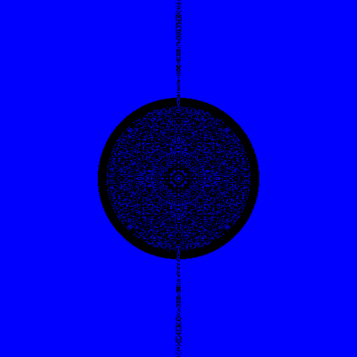

# Schwarzschild Ray Tracer

**Simulating gravitational lensing and photon trajectories in Schwarzschild spacetime using inverse ray tracing and general relativity.**
Read the implementation details [here!](Phys_129L_Final_Project_Report-3.pdf) 


## 📜 Overview

This project numerically integrates null geodesics to simulate how light bends around a non-rotating Schwarzschild black hole. By back-tracing rays from an observer's camera through curved spacetime, we recreate gravitational lensing, photon rings, and black hole shadows.

The final output demonstrates how black holes appear to distant observers—mimicking features captured in telescope imagery and theoretical models.

---

## Key Features

- **Geodesic Integration**: Solves the null geodesic equations with the `FANTASY` order-2 symplectic scheme, implemented as a Numba-CUDA kernel (EinsteinPy is used only by the diagnostic scripts and tests). Run the kernels on the CPU with `NUMBA_ENABLE_CUDASIM=1`.
- **GPU Acceleration**: Massive speedup through Numba-CUDA support
- **Realistic Rendering**: Projects a background panorama to simulate lensing distortions
- **Schwarzschild Geometry**: Pure Schwarzschild spacetime with no spin
- **Equirectangular Mapping**: Converts escape directions to texture coordinates on a celestial sphere

---

##  Technical Details

- **Metric**: Schwarzschild (static, spherically symmetric)
- **Observer**: Positioned far from the black hole on the +x axis
- **Resolution**: Configurable grid of rays (e.g., 400×400)
- **Integration**: Symplectic solver using affine parameter $\lambda$
- **Output**: Rendered RGB image combining captured rays and background sky


---

## Camera pointing

The observer sits on the `+x` axis and, unrotated, looks at the black hole: optical
axis `−x̂`, right `+ŷ`, up `+ẑ`. The camera can turn (pan) but not move, because the
equatorial rotation that brings every ray into the x–y plane keeps only an observer on
`+x` fixed. The viewer basis is turned by three intrinsic angles, in degrees, applied
in this order and each right-handed about the named axis of the camera as it then
stands:

| Flag | Axis | Positive value |
| --- | --- | --- |
| `--yaw` | up | looks to the observer's left, so the black hole moves right in the image |
| `--pitch` | right (after the yaw) | looks up, so the black hole moves down |
| `--roll` | optical axis (after yaw and pitch) | turns the image counter-clockwise as seen by the viewer |

Intrinsic yaw → pitch → roll equals `R_up(yaw) · R_right(pitch) · R_axis(roll)` about
the *unrotated* axes (`simulation.utils.camera_basis`). Ray directions are unit vectors
in the static observer's orthonormal frame, so the field of view is the angle the
observer measures; the rotated directions feed the same momentum construction as
before. With all angles zero the basis is exactly the old one. Both the curved render
and the no-gravity reference use the same camera (`simulation.utils.pixel_positions`);
row `i = 0` of the pixel grid is the bottom row of the image.

## Accretion disk

`--disk` adds a geometrically thin, opaque sheet of material on circular Keplerian
orbits in a plane through the black hole (`simulation/disk.py`, a port of the Rust
build's `disk.rs` with the same operation order).

**Geometry.** The disk plane is `n · x = 0`. `--disk-inclination` (default 75°) is the
angle between `n` and the observer's position vector `+x̂`: 0 face-on, 90 edge-on, 180
face-on from the other side, which reverses the sense of rotation on the sky.
`--disk-azimuth` (default 0°) turns `n` right-handedly about `+x̂`:
`n = R_x(azimuth) · (cos i, 0, sin i)`. At azimuth 0 an inclined disk's near side is
below the black hole and its far side above. Both angles are measured against the
observer's position, not the optical axis, so turning the camera does not move the
disk. The material orbits right-handedly about `n` (at `x` it moves along `n × x̂`):
edge-on with `n = +ẑ`, the left side of the disk approaches the observer and is
blueshifted. `--disk-inner` defaults to the ISCO, `6M`, and may not be smaller;
`--disk-outer` (default `20M`) must stay below `--observer-distance`.

**Crossings.** Each ray carries the azimuth `phi_d` at which the disk plane cuts its
orbital plane (`Disk.ray_frame`). The integrator kernel checks after every step, from
the second step on, whether `floor((φ − phi_d)/π)` changed by exactly one, interpolates
the crossing radius linearly in `φ`, counts the crossing, and ends the ray (status 4,
collision `disk`) when the radius lies in `[r_in, r_out]`. `φ` is never wrapped. With
the disk off the kernel reproduces the previous results bit for bit.

**Redshift.** With `p_t`, `p_φ` the ray's conserved initial momenta in its rotated
frame, `n'_z` the component of the disk normal along the ray's angular momentum,
`b_z = −p_φ n'_z / p_t` and `Ω = √(M/r³)`, the ratio of observed to emitted frequency is

```
g = √(1 − 3M/r) / ((1 − Ω b_z) √(1 − 2M/r_obs))
```

for the static observer and the circular orbit at the hit. A hit with `g` not finite
and positive is physically impossible and is reported as a `numerical error` (red).

**Emission and colour.** The effective temperature follows the Shakura–Sunyaev profile
`T⁴ ∝ (1 − √(r_in/r)) / r³`, which peaks at `r = 49/36 r_in`; the peak value is
`--disk-temperature` (default 6000 K). The observed spectrum is a blackbody at `gT`:
the pixel is the chromaticity of a blackbody at `gT` (Kang et al. 2002 fit of the
Planckian locus → linear sRGB, largest channel 1) scaled by the tone-mapped intensity
`1 − exp(−2 (gT/T_peak)⁴)`, then sRGB-encoded. The temperature is a **false-colour**
parameter: it sets the hue, not the physics; at realistic disk temperatures every
pixel would be white. The no-gravity image draws the disk with `g = 1`.

**Output.** `photon_data.csv` keeps its previous columns and gains, in this order,
`disk_r`, `disk_phi` (hit radius and azimuth in the ray's rotated frame), `disk_x`,
`disk_y`, `disk_z` (lab-frame hit position), `disk_g`, `disk_temp` (kelvin), all NaN
unless the ray ended on the disk, and `plane_crossings`, which counts every crossing of
the disk plane, the hit included (0 without a disk). The summaries report `Hit disk`.

```
NUMBA_ENABLE_CUDASIM=1 python main.py --size 100 --steps 20000 --disk --disk-inclination 75 --yaw 6 --pitch -4
```

Tests: `NUMBA_ENABLE_CUDASIM=1 python -m pytest tests/test_fixes.py tests/test_disk.py`.
`tests/gen_disk_fixture.py` records a 16×16 disk scene (`tests/fixtures/disk_scene.json`)
for comparison with the Rust build.
